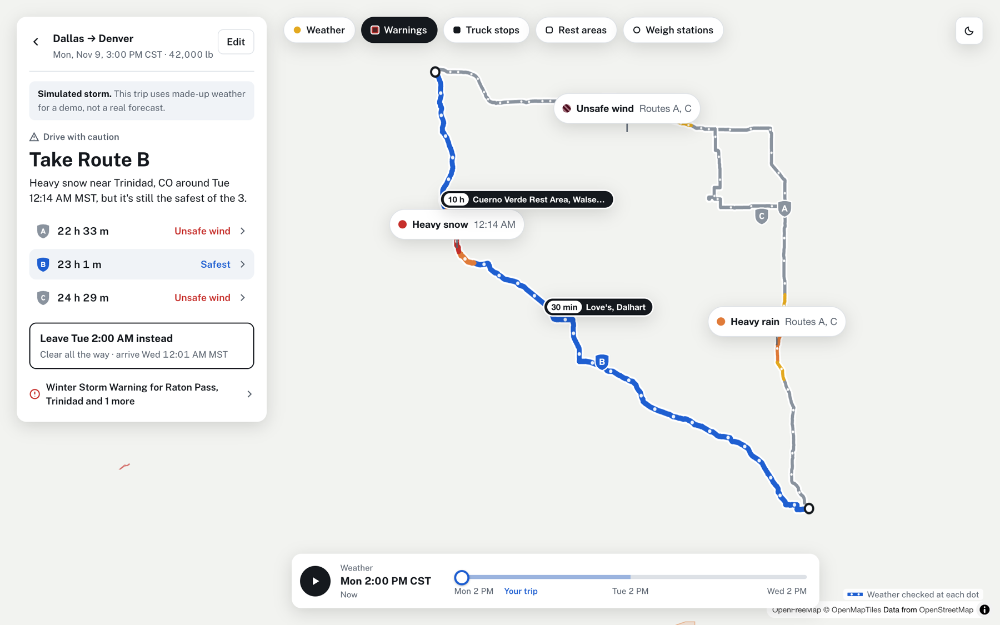
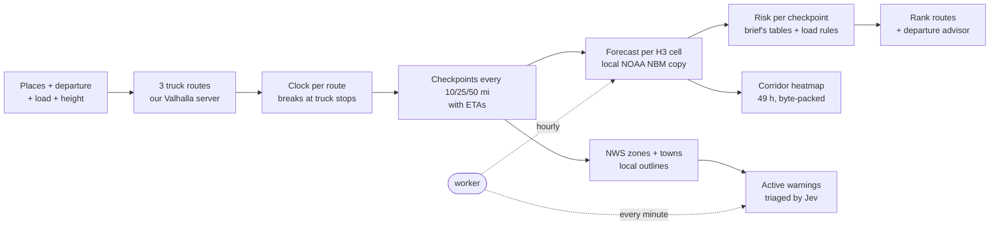

# Weather-Aware Truck Routing

A truck driver picks a start, an end, a departure time, a load weight and the truck's height. The app finds three truck routes, checks the forecast **at the time the truck will actually reach each part of each route** (rest stops included), rates every checkpoint with the brief's risk rules, and recommends the safest route — or a safer time to leave.

It's a pre-trip check, not a navigation app: decide here which road and when, then drive with whatever app you use.

**Live app:** https://spotter-weather-routing-khaki.vercel.app
&nbsp;·&nbsp; **API docs:** https://api-production-e386.up.railway.app/api/docs

> The real forecast is calm most days. To see the product working, click **"Or try Dallas → Denver in a simulated storm"** on the plan form. That trip uses a clearly labelled, made-up storm (snow on Raton Pass, high wind on I-70, rain in Oklahoma); everything else — routes, timing, rules, ranking, warnings triage — is real.



## What you see

- **One answer first.** "Take Route B", why, and the three routes in a word each ("Safest", "Unsafe wind", "33 m slower").
- **Routes coloured by their own risk**, checkpoints as dots, rest stops, and pins on the stretches of High-or-worse weather.
- **A 0–48 h forecast slider** with an H3 hexagon heatmap of the corridor. Moving it never touches the network.
- **Leave later**: if waiting makes the trip safer, the app says when to leave and what changes.
- **Official NWS warnings** on each route, triaged by Jev (TypeSafe AI) for whether they matter to a heavy truck.
- **Details on demand**: stop-by-stop table with local times and towns, ranking reasons, and a space-time chart.
- **Truck-aware**: routes avoid bridges lower than the truck and roads closed to its weight or a hazmat load; required breaks and rests are planned at real truck stops and rest areas; weigh stations are marked.
- **Type the trip** ("Dallas to Denver tomorrow after lunch, 42k lbs") to fill the form; light and dark themes; phone layout.

## How it works



Nothing on that path waits on someone else's server. A worker keeps the forecast, zone outlines and warnings on disk and in Redis; routing runs on our own Valhalla server. Every one of them falls back to a public API if the local copy is missing or stale.

1. **Routes.** [Valhalla](https://github.com/valhalla/valhalla) in truck mode, on our own server, built from OpenStreetMap: the truck's gross weight, height and hazmat status keep it off roads it can't use. TomTom's truck routing is the backup if the server is down. Providers often return near-duplicates, so routes sharing more than 80% of their road (compared as sets of H3 cells) are dropped and gaps are filled through via points pushed sideways from the best route.
2. **When the truck is where.** Federal Hours-of-Service rules turn driving time into clock time: a 30-minute break after 8 h of driving and a 10-hour rest after 11 h. Each stop moves back to the last truck stop or rest area within 90 minutes of driving before the limit (from OpenStreetMap), so it lands where a truck can actually park. On Dallas → Denver this moves the second half of the trip by ten hours, which decides whether the truck meets a storm or misses it.
3. **Checkpoints** sit every 10, 25 or 50 miles. Each stands for the half-spacing either side of it, so "Severe miles" is a real distance.
4. **Weather.** NOAA's National Blend of Models (NBM, 2.5 km), straight from NOAA's public S3 bucket. Every hour the worker fetches only the six fields the rules read, by byte range (~750 MB instead of ~25 GB per run), and samples them onto every ~3 km H3 cell in the US: one 365 MB array, memory-mapped. A trip's forecast is a few thousand row reads, about 0.2 s. NBM is hourly for 48 h, then 3-hourly: wind is interpolated, totals spread over their window; rain is precipitation minus the snow's water. The copy matches Open-Meteo's NBM to 0.1 mph where both have the same point. Cells outside it (Alaska, Hawaii) come from Open-Meteo's GFS. Rain, snow and gusts are read for the hour ending at the ETA, wind at the ETA.
5. **Risk** comes from the brief's tables, then the load rules (≥ 55 mph: No Travel; 45–54 mph over 30,000 lb: No Travel; 35–44 mph over 40,000 lb: Severe). One table-driven function, tested on every boundary.
6. **Ranking** follows the brief: fewest Severe miles → fewest High miles → lowest average risk → shortest time, with two gates in front (see decisions below). Each value is rounded to a stated tolerance first, so floating-point noise can't flip a result.
7. **Leave later.** The same forecast is re-scored for departures up to 24 h later, at no extra API cost. Risk is compared first, then arrival time, so it never says "wait 13 hours to save 30 minutes".
8. **Heatmap.** A 15-mile buffer around the routes is filled with ~3 km H3 cells, each read from the forecast copy (with Open-Meteo, a coarser grid is spread by inverse-distance weighting). 49 hours of levels ship as one base64 byte array, so the slider is pure client-side work.
9. **Warnings.** The NWS's own zone and county outlines say which zones each point is in, and the nearest OpenStreetMap town names it; the worker pulls every active US alert once a minute. Alerts are matched by zone code (or polygon) and kept only if the truck reaches that stretch while the alert is in effect. The text shown is the alert's own *What* and *Impacts* lines.
10. **Weigh stations** within 0.3 mi of each route, with the time the truck passes them.

## Where AI is used (and where it isn't)

Jev is TypeSafe AI's decision model: it answers typed questions (yes/no with a probability, or a pick from a list) instead of writing text. It's used where a judgement is needed and the answer feeds code:

| Where | Jev decides | If Jev is down or slow |
|---|---|---|
| Official warnings | Does this alert make driving a loaded, high-sided truck more dangerous? What's the hazard? Does it warn of closed roads? | Keyword table over NWS event names |
| Typed trip | Which day and roughly what hour ("after lunch", "first thing Monday"), picked from concrete dated options because it can't do date arithmetic | Keyword rules ("tomorrow", "morning") |

Places, loads, exact times, risk levels and the ranking are plain code. The UI flags anything Jev was unsure of.

## Decisions on ambiguous rules

| Question | Decision |
|---|---|
| Band edges overlap (rain 0.25, snow 1.0 …) | Lower edge inclusive: 0.25 in/hr is High. Top bands as written: exactly 1.00 in/hr rain is Severe, more is No Travel. |
| No Travel isn't in the ranking rules | A hard gate: a route with any No Travel miles ranks below every route without. If all have some, advise waiting. |
| Weather beyond the forecast (trips days out) | Ranked right after No Travel: a route can't win because its storm isn't visible yet. |
| Sustained wind or gusts | Sustained by default, as the table says; gust and worst-of-both are options, used by the map too. |
| Car vs truck timing | Truck routing where available, speed cap otherwise, plus mandatory breaks and rests. |
| Time zones | Departure is the origin's local time; every time shown carries its zone. |

More detail: [problem and decisions](docs/01-problem.md) · [research](docs/02-research.md) · [planning notes](docs/03-architecture-plan.md) (written before the build; the code is the source of truth).

## Performance

- New area, cold caches: about 2–3 s, most of it the three truck routes from Valhalla. Weather (~0.5 s), warnings and place names are local reads. Same trip again: about 0.5 s, from Redis.
- With TomTom instead of Valhalla, routing alone takes 2–8 s; with Open-Meteo instead of the local forecast, weather takes 1–4 s.
- A full trip response is ~50 KB gzipped; the slider and charts never call the API. The map's place layers (~85 KB) and warning outlines (~75 KB) load once, when switched on.
- Moving the slider only recolours the heatmap layer; route geometry is built once per trip.

## Project layout

```
backend/                 Django 6 + Django Ninja (ASGI), Python 3.12, uv
  engine/                pure, tested logic: rules, geometry, HOS clock, checkpoints, scoring, advisor, corridor
  providers/             Valhalla/TomTom/OSRM routing, NBM copy and Open-Meteo weather, NWS zones and alerts,
                         OpenStreetMap places, Jev client, demo storm
  trips/                 the pipeline (service), response building, warnings, triage, typed-trip parser
  api/                   HTTP endpoints (/trips, /places, /parse, /alerts, /pois, /health) and the `worker` command
  data/                  truck stops, rest areas, weigh stations and towns from OpenStreetMap (ODbL)
frontend/src/            React 19 + TypeScript, MapLibre + deck.gl, TanStack Query, zustand, Tailwind
  lib/                   plain-language summaries, itinerary rows, route geometry, time formatting
  components/            home/, answer card, map/, details/, form/, the phone's bottom sheet, forecast slider
scripts/                 extract_osm.py: rebuilds backend/data from Geofabrik's US extracts
docs/                    problem, research and architecture notes
```

## Run locally

Needs Python 3.12 with [uv](https://docs.astral.sh/uv/), Node 24 and Docker (for Redis).

```bash
cp .env.example .env    # optional: VALHALLA_URL or TOMTOM_API_KEY (else OSRM), TYPESAFE_API_KEY (else keyword rules)
make setup              # uv sync + npm ci
make services           # Redis in Docker
make backend            # http://localhost:8000/api/docs
make worker             # optional: local forecast, zones and alerts (first run ~2 min)
make frontend           # http://localhost:5173
make check              # lint, types and tests, as CI runs them
```

## Tests and quality

- **168 backend tests** (pytest, Hypothesis): every rule boundary, the HOS clock (including a property test that stops moved to truck stops never break the hours rules), ranking order and ties, the departure advisor, the NOAA field handling (time axes, overlapping totals, rain and snow), providers against mocked HTTP responses, the routing fallback, warnings matching and triage fallbacks, the full pipeline offline, and that upstream errors never expose API keys.
- **27 frontend tests** (Vitest) for the plain-language logic: verdicts, pins, stop rows, stop labels, time zones, recent trips and the saved truck.
- ruff, mypy (strict), oxlint and TypeScript run in CI on every push.

## Deployment

- **API, worker and Redis** on Railway. One container (`backend/Dockerfile`, `start.sh`) runs the API and the data worker side by side so both use one volume at `/data` (`DATA_DIR`): the forecast copy (~365 MB per run, two kept), the NWS outlines and their index. The worker restarts if it exits; until its first sync finishes (~2 min), trips use Open-Meteo and api.weather.gov.
- **Routing** on our own Valhalla server (AWS, us-east-1, next to Railway), built from Geofabrik's US extract in Docker ([valhalla-scripted](https://github.com/valhalla/valhalla/tree/master/docker)). The US tiles are ~20 GB; serving takes ~6 GB of memory. TomTom is the backup if it doesn't answer within 10 s.
- **Frontend** on Vercel; `vercel.json` forwards `/api/*` to the Railway API, so the browser talks to one origin.
- Keys and the Valhalla URL live only in Railway's environment variables. `backend/data/osm_places.csv.gz` is rebuilt with `scripts/extract_osm.py` when the map data should be refreshed.

## Limits and next steps

- The frontend's API types are hand-written because `openapi-typescript` doesn't support TypeScript 7 yet.
- There are no component tests yet; the logic the components show is tested in `lib/`.
- OpenStreetMap's truck-stop, rest-area and weigh-station coverage is good on interstates and patchy elsewhere; there is no open source for truck parking availability or whether a weigh station is open.
- The forecast copy covers the lower 48 (NOAA's CONUS grid); trips elsewhere use Open-Meteo's GFS.
- Next: live traffic in route timing, push alerts when the forecast changes before departure, and a dispatcher view across many trucks.
