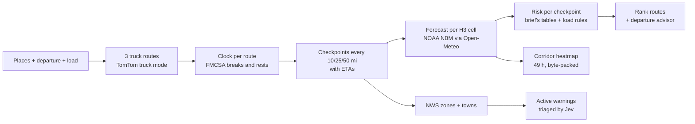

# Weather-Aware Truck Routing

A truck driver picks a start, an end, a departure time and a load weight. The app finds three truck routes, checks the forecast **at the time the truck will actually reach each part of each route** (rest stops included), rates every checkpoint with the brief's risk rules, and recommends the safest route — or a safer time to leave.

**Live app:** https://spotter-weather-routing-khaki.vercel.app
&nbsp;·&nbsp; **API docs:** https://api-production-e386.up.railway.app/api/docs

> The real forecast is calm most days. To see the product working, click **"Or try Dallas → Denver in a simulated storm"** on the plan form. That trip uses a clearly labelled, made-up storm (snow on Raton Pass, high wind on I-70, rain in Oklahoma); everything else — routes, timing, rules, ranking, warnings triage — is real.


## What you see

- **One answer first.** "Take Route B", why, and the three routes in a word each ("Safest", "Unsafe wind", "33 m slower").
- **Routes coloured by their own risk**, checkpoints as dots, rest stops, and pins on the stretches of High-or-worse weather.
- **A 0–48 h forecast slider** with an H3 hexagon heatmap of the corridor. Moving it never touches the network.
- **Leave later**: if waiting makes the trip safer, the app says when to leave and what changes.
- **Official NWS warnings** on each route, triaged by Jev (TypeSafe AI) for whether they matter to a heavy truck.
- **Details on demand**: stop-by-stop table with local times and towns, ranking reasons, and a space-time chart.
- **Type the trip** ("Dallas to Denver tomorrow after lunch, 42k lbs") to fill the form; light and dark themes; phone layout.

## How it works



1. **Routes.** TomTom Routing in truck mode with the truck's gross weight. Providers often return near-duplicates, so routes sharing more than 80% of their road (compared as sets of H3 cells) are dropped and gaps are filled through via points pushed sideways from the best route. OSRM is a keyless fallback with speeds capped at 65 mph.
2. **When the truck is where.** Federal Hours-of-Service rules turn driving time into clock time: a 30-minute break after 8 h of driving and a 10-hour rest after 11 h. On Dallas → Denver this moves the second half of the trip by ten hours, which decides whether the truck meets a storm or misses it.
3. **Checkpoints** sit every 10, 25 or 50 miles. Each stands for the half-spacing either side of it, so "Severe miles" is a real distance.
4. **Weather.** Each checkpoint maps to an H3 cell (~1 km). All cells for all three routes go to Open-Meteo in batched requests, using NOAA's National Blend of Models (2.5 km, US), with GFS where NBM has no data. Forecasts are cached per model run and cell, so a second trip through the same area is near-instant. Rain, snow and gusts are read for the hour ending at the ETA, wind at the ETA.
5. **Risk** comes from the brief's tables, then the load rules (≥ 55 mph: No Travel; 45–54 mph over 30,000 lb: No Travel; 35–44 mph over 40,000 lb: Severe). One table-driven function, tested on every boundary.
6. **Ranking** follows the brief: fewest Severe miles → fewest High miles → lowest average risk → shortest time, with two gates in front (see decisions below). Each value is rounded to a stated tolerance first, so floating-point noise can't flip a result.
7. **Leave later.** The same forecast is re-scored for departures up to 24 h later, at no extra API cost. Risk is compared first, then arrival time, so it never says "wait 13 hours to save 30 minutes".
8. **Heatmap.** A 15-mile buffer around the routes is filled with H3 cells; weather is sampled on a coarser grid and spread with inverse-distance weighting. 49 hours of levels for ~4,000 cells ship as one base64 byte array (~44 KB gzipped for the whole trip), so the slider is pure client-side work.
9. **Warnings.** NWS `/points` names the forecast zone, county and town every ~20 miles; active alerts for those states are matched by zone code (or polygon) and kept only if the truck reaches that stretch while the alert is in effect. The text shown is the alert's own *What* and *Impacts* lines.

## Where AI is used (and where it isn't)

Jev is TypeSafe AI's decision model: it answers typed questions (yes/no with a probability, or a pick from a list) instead of writing text. It's used where a judgement is needed and the answer feeds code:

| Where | Jev decides | If Jev is down or slow |
|---|---|---|
| Official warnings | Does this alert make driving a loaded, high-sided truck more dangerous? What's the hazard? Does it warn of closed roads? | Keyword table over NWS event names |
| Typed trip | Which day and roughly what hour ("after lunch", "first thing Monday"), picked from concrete dated options because it can't do date arithmetic | Keyword rules ("tomorrow", "morning") |

Places, loads, exact times, risk levels and the ranking are plain code. The UI flags anything Jev was unsure of.

## Decisions on ambiguous rules

| Question | Decision |
|---|---|
| Band edges overlap (rain 0.25, snow 1.0 …) | Lower edge inclusive: 0.25 in/hr is High. Top bands as written: exactly 1.00 in/hr rain is Severe, more is No Travel. |
| No Travel isn't in the ranking rules | A hard gate: a route with any No Travel miles ranks below every route without. If all have some, advise waiting. |
| Weather beyond the forecast (trips days out) | Ranked right after No Travel: a route can't win because its storm isn't visible yet. |
| Sustained wind or gusts | Sustained by default, as the table says; gust and worst-of-both are options, used by the map too. |
| Car vs truck timing | Truck routing where available, speed cap otherwise, plus mandatory breaks and rests. |
| Time zones | Departure is the origin's local time; every time shown carries its zone. |

More detail: [problem and decisions](docs/01-problem.md) · [research](docs/02-research.md) · [planning notes](docs/03-architecture-plan.md) (written before the build; the code is the source of truth).

## Performance

- New area, cold caches: ~8 s, mostly the three TomTom route requests. Same trip again: under 1 s; the forecast and NWS lookups are cached in Redis.
- A full trip response is ~44 KB gzipped; the slider and charts never call the API.
- Moving the slider only recolours the heatmap layer; route geometry is built once per trip.

## Project layout

```
backend/                 Django 6 + Django Ninja (ASGI), Python 3.12, uv
  engine/                pure, tested logic: rules, geometry, HOS clock, checkpoints, scoring, advisor, corridor
  providers/             TomTom/OSRM routing, Open-Meteo weather, NWS, places, Jev client, demo storm
  trips/                 the pipeline (service), response building, warnings, triage, typed-trip parser
  api/                   HTTP endpoints: /trips, /places, /parse, /health
frontend/src/            React 19 + TypeScript, MapLibre + deck.gl, TanStack Query, zustand, Tailwind
  lib/                   plain-language summaries, itinerary rows, route geometry, time formatting
  components/            answer card, map/, details/, form/, forecast slider
docs/                    problem, research and architecture notes
```

## Run locally

Needs Python 3.12 with [uv](https://docs.astral.sh/uv/), Node 24 and Docker (for Redis).

```bash
cp .env.example .env    # optional keys: TOMTOM_API_KEY (else OSRM), TYPESAFE_API_KEY (else keyword rules)
make setup              # uv sync + npm ci
make services           # Redis in Docker
make backend            # http://localhost:8000/api/docs
make frontend           # http://localhost:5173
make check              # lint, types and tests, as CI runs them
```

## Tests and quality

- **145 backend tests** (pytest, Hypothesis): every rule boundary, the HOS clock, ranking order and ties, the departure advisor, providers against mocked HTTP responses, warnings matching and triage fallbacks, the full pipeline offline, and that upstream errors never expose API keys.
- **19 frontend tests** (Vitest) for the plain-language logic: verdicts, pins, stop rows, time zones.
- ruff, mypy (strict), oxlint and TypeScript run in CI on every push.

## Deployment

- **API + Redis** on Railway, built from `backend/Dockerfile`. Keys live only in Railway's environment variables.
- **Frontend** on Vercel; `vercel.json` forwards `/api/*` to the Railway API, so the browser talks to one origin.

## Limits and next steps

- The frontend's API types are hand-written because `openapi-typescript` doesn't support TypeScript 7 yet.
- There are no component tests yet; the logic the components show is tested in `lib/`.
- Next: live traffic in route timing, push alerts when the forecast changes before departure, and a dispatcher view across many trucks.
